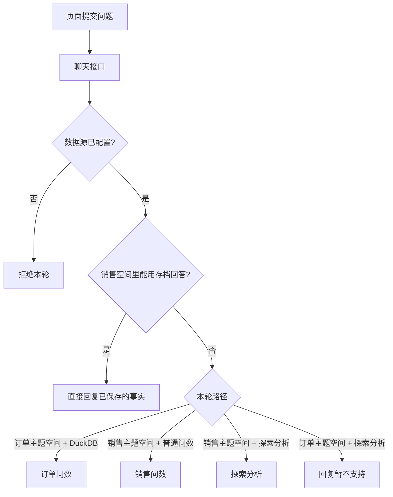
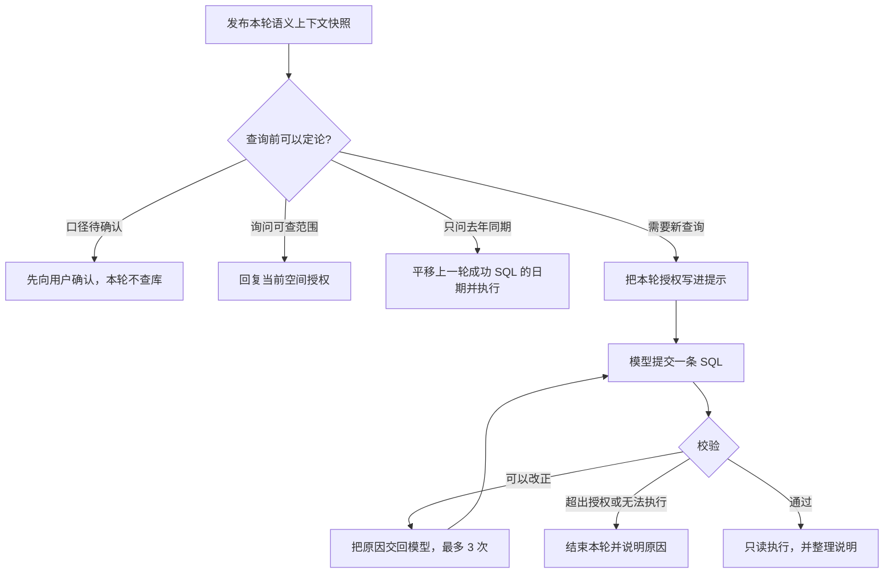
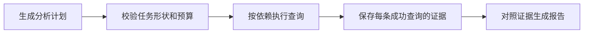

# Data Agent

用自然语言查询已授权业务数据的本地工作台。页面展示问数过程、结果和说明。

当前默认运行的是订单主题空间，数据库是 DuckDB。引擎和主题空间写在 `backend/configs/data_source.yaml`，启动时只认这份配置。

本文先说明系统怎么设计，再说明怎么在本机运行。名词以 [GLOSSARY.md](GLOSSARY.md) 为准，已经定下的设计在 [docs/adr/](docs/adr/)。

## 目录

1. [概述](#overview)
2. [架构](#architecture)
   1. [系统组成](#components)
   2. [一次提问的主流程](#main-flow)
   3. [订单问数](#orders-query)
   4. [销售问数](#sales-query)
   5. [探索分析](#analysis)
   6. [设计原则](#principles)
3. [快速开始](#getting-started)
4. [配置](#configuration)
5. [测试](#testing)
6. [延伸阅读](#further-reading)

<a id="overview"></a>

## 1. 概述

工作台有两种工作方式。

- **普通问数**按用户给出的指标、维度和筛选返回查询结果。
- **探索分析**围绕一个业务问题分多步取证，再形成报告。目前只在销售主题空间启用。

一次提问的模式可以是自动、普通问数或探索分析。显式选择优先。自动模式只在销售主题空间、且问题是在查异常或原因时进入探索分析。

读者可以按目录跳读：想看设计从第 2 节开始，想在本机跑起来从第 3 节开始。

<a id="architecture"></a>

## 2. 架构

模型负责把问题变成查询或分析计划。服务负责授权、校验、只读执行，以及和证据对得上的数字。下面按组成、主流程和三条业务路径说明。

<a id="components"></a>

### 2.1 系统组成

| 部分 | 职责 | 位置 |
| --- | --- | --- |
| 页面 | 对话、模式切换、过程与结果展示 | `frontend/` |
| 聊天接口 | 接收提问，用 SSE 推送过程和结果 | `POST /api/chat/stream` |
| 模型运行时 | 调用兼容 OpenAI 的模型 | OpenAI Agents SDK |
| 语义与执行 | 发布授权、校验查询、只读查库 | `backend/app/` |
| 会话 | 保存消息、上一轮成功查询、待澄清问题 | `data/conversations.db` |
| 数据源 | 按配置连接 DuckDB、SQLite 或 PostgreSQL | `backend/configs/data_source.yaml` |

同一会话同时只处理一轮。成功的查询会留下可续问的条件：订单路径留下已执行的 SQL，销售路径留下结构化查询。

<a id="main-flow"></a>

### 2.2 一次提问的主流程

页面把问题、会话标识和模式发给聊天接口。服务先确认数据源已经配好，再决定本轮走哪条路径。



三条路径的差别：

| | 订单问数 | 销售问数 | 探索分析 |
| --- | --- | --- | --- |
| 何时启用 | 配置为 DuckDB 和订单主题空间 | 配置为销售主题空间，且选择普通问数 | 配置为销售主题空间，且选择探索分析，或自动模式识别出诊断意图 |
| 模型提交 | 一条 DuckDB SQL | 指标、维度、筛选和时间范围 | 分析计划，以及可选的报告重点 |
| 服务负责 | 校验授权和粒度，只读执行 | 生成 SQL，只读执行 | 安排任务、保存证据、对照证据写报告 |
| 当前默认 | 是 | 改配置后启用 | 改配置后启用 |

<a id="orders-query"></a>

### 2.3 订单问数

这是当前默认路径。规范语义模型定义业务对象、指标、数据集和物理字段。主题空间授权决定这次能用其中哪些。每个请求开始时发布一份语义上下文快照，提示、校验和执行读同一份。



读这张图时，按这个顺序理解：

1. **能在查库前结束的，先结束。** 口径不清时先澄清。用户用短回复接续时，保留原问题里已经给出的条件，再按本轮快照核对。询问可查范围时，回复授权原文。
2. **去年同期由服务计算日期。** 服务取最近一次成功 SQL，把起止日期各向前移一个自然年，重新校验后执行。上一轮没有日期范围时，先请用户补上。
3. **新查询由模型写 SQL，由服务执行。** 校验确认语句只读，表、列和指标表达式都在授权内，连接后订单指标没有被重复放大。可改正的 SQL 交回模型，改完再校验。超出授权则结束本轮。
4. **页面过程来自已经发生的动作。** 步骤是理解问题、一次查询、整理说明。查询标题从当次 SQL 抽出。

大空间里，检索可以少放进提示的数据集。校验和执行仍使用完整授权。已授权但没进提示的数据集，可以补进本轮上下文后再生成 SQL。

代码在 `backend/app/main.py`、`backend/app/semantic/snapshot.py`、`backend/app/direct_sql.py`、`backend/app/order_clarification.py`。决定见 [ADR 0003](docs/adr/0003-direct-sql-duckdb-first.md)、[ADR 0006](docs/adr/0006-space-authorization-bounds-retrieval.md)、[ADR 0007](docs/adr/0007-readonly-sql-with-fanout.md)、[ADR 0008](docs/adr/0008-order-query-clarification.md)。

<a id="sales-query"></a>

### 2.4 销售问数

把 `data_source.yaml` 的 `space` 改为 `sales` 后，普通问数走结构化查询。模型提交指标、维度、筛选和时间范围。服务按 `backend/configs/sales_space.yaml` 校验，生成 SQL，再只读执行。

用户没有给出时间时，范围是今年 1 月 1 日到当前业务日期，时区为 Asia/Shanghai。销售汇总数据在内置 SQLite 示例库中。当前这份订单 DuckDB 里没有销售汇总表。

若问题是在追问本会话已经保存的查询范围、业务日期覆盖或某次分析任务，服务用存档回答，不再发起新查询。见 `backend/app/sales_turn.py` 和 [ADR 0001](docs/adr/0001-structured-sales-query-boundary.md)。

<a id="analysis"></a>

### 2.5 探索分析

探索分析在销售主题空间启用。订单主题空间收到这个模式时，回复暂不支持。



模型产出计划，并可从已验证的重点里选一个报告重点。任务顺序、停止条件、统计和报告中的数字由服务确定。任务限于范围检查、每日趋势、单维度分布，以及由门店分布证据引出的一层产品下钻。依赖失败时跳过下游任务。报告与证据不一致时不展示结论，已经取得的证据仍保留。

预算和统计阈值可用 `SALES_ANALYSIS_BUDGET`、`SALES_ANALYSIS_THRESHOLDS` 覆盖。见 [ADR 0009](docs/adr/0009-analysis-mode-orchestration.md)。

<a id="principles"></a>

### 2.6 设计原则

1. **配置决定路径。** `engine` 和 `space` 决定本轮是订单问数、销售问数还是探索分析。DuckDB 路径来自 `SALES_DUCKDB_PATH`。路径未配置时拒绝问数，不创建 SQLite 示例库。
2. **模型提案，服务执行。** 模型提交 SQL、结构化查询或分析计划。授权范围、SQL 生成、只读执行和数字核对在 Python 服务中完成。
3. **一次请求一份授权。** 订单问数在开始时冻结语义上下文快照。提示可以比授权更窄，执行不能比授权更宽。
4. **续问使用上一轮已经验证的结果。** 去年同期、结果说明，以及销售空间里的存档追问，都从会话中已保存的查询出发。
5. **过程只记录本轮做过的事。** 页面上的步骤对应理解、查询和整理，标题来自当次查询。

<a id="getting-started"></a>

## 3. 快速开始

需要 Python 3.11 或更高版本，以及 Node.js 20 或更高版本。

启动后端：

```sh
python -m venv .venv
source .venv/bin/activate
pip install -r backend/requirements.txt
cp .env.example .env
# 编辑 .env，填写 OPENAI_API_KEY 和服务商提供的 OPENAI_MODEL
set -a
source .env
set +a
cd backend
uvicorn app.main:app --reload
```

另开终端启动前端：

```sh
cd frontend
npm install
npm run dev
```

打开 http://127.0.0.1:5173。订单问数还需要在 `.env` 中设置 `SALES_DUCKDB_PATH`，指向只读打开的 DuckDB 文件。

`.env` 不会自动加载。每次启动后端前，在该终端执行 `set -a && source .env && set +a`。API 地址由 `OPENAI_BASE_URL` 配置，默认是 `https://api.agicto.cn/v1`，模型名称使用该地址支持的模型。`.env` 已加入 Git 忽略列表。

<a id="configuration"></a>

## 4. 配置

| 配置 | 位置 | 作用 |
| --- | --- | --- |
| `engine`、`space` | `backend/configs/data_source.yaml` | 选择数据库引擎和主题空间。当前是 `duckdb` 与 `orders` |
| `SALES_DUCKDB_PATH` | `.env` | DuckDB 文件的绝对路径 |
| `SALES_SQLITE_PATH` | `.env` | 外部 SQLite 文件。`engine` 为 `sqlite` 且未设置此项时，创建内置示例库 |
| `SALES_DATABASE_URL` | `.env` | PostgreSQL 连接串。`engine` 为 `postgresql` 时使用 |
| `OPENAI_API_KEY`、`OPENAI_MODEL`、`OPENAI_BASE_URL` | `.env` | 模型密钥、名称和兼容接口地址 |
| `LANGSMITH_API_KEY` 或 `LANGCHAIN_API_KEY` | `.env` | 可选。设置后把模型和工具的输入输出发往 LangSmith |

改引擎时先改 `data_source.yaml` 的 `engine`，再提供对应路径或连接串，然后重启后端。销售主题空间使用销售汇总模型，订单 DuckDB 不作为销售数据源。

连接 PostgreSQL 时，在销售模型的 `models.sales_summary` 下填写 `schema`，并配置允许的表、字段和指标表达式。数据库账户只授予该 schema 和表的 SELECT。服务使用只读事务、5 秒连接和语句超时、参数绑定和表字段白名单。

接入前核对业务日期的字段类型、销售额和退款口径、订单粒度，以及订单量能否在每个启用维度上加总。实现支持 PostgreSQL、DuckDB 和 SQLite。接到生产库时，用该库完成连通性和口径验收。

启用 LangSmith 后，用户问题、SQL 和结果行会随 span 发出。追踪发往 LangSmith，不发往 OpenAI 的追踪地址。

<a id="testing"></a>

## 5. 测试

回归测试和前端构建：

```sh
PYTHONPATH=backend pytest backend/tests
npm --prefix frontend run build
```

销售标准题使用固定业务日期 2026-06-01 和独立 SQLite。它验收结构化查询，不验收当前订单路径。输出包含每条 Query IR、SQL、执行状态、结果和失败环节。

```sh
PYTHONPATH=backend python -m app.evaluation.runner
```

销售题的真实模型解析：

```sh
PYTHONPATH=backend python -m app.evaluation.runner --live
```

订单题在 `backend/app/evaluation/orders_golden.json`。先加载 `.env`，并把 `SALES_DUCKDB_PATH` 指到 Jaffle Shop DuckDB。

```sh
PYTHONPATH=backend python -m app.evaluation.runner --orders
```

真实模型命令会调用服务并可能产生费用。未设置密钥时，对应用例记为 skipped。订单问数题比对结果行。拒绝题应无结果行。「去年同期」沿用同一会话，核对日期已平移且结果为空。「能查什么」回复当前空间授权原文。执行器和校验器的回归在 `backend/tests/test_direct_sql_chat.py`。

<a id="further-reading"></a>

## 6. 延伸阅读

| 文档 | 用来查什么 |
| --- | --- |
| [GLOSSARY.md](GLOSSARY.md) | 业务名词 |
| [docs/adr/](docs/adr/) | 已经做出的设计决定 |
| [docs/wiki/index.md](docs/wiki/index.md) | 跨会话仍有效的事实。当前代码以本文件和代码为准 |
